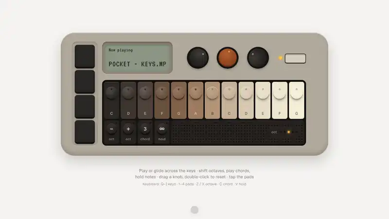

# Pocket Keys interaction

A small desk synth you can actually play. Twelve domed keys ramp from charcoal to cream; each cap sinks and lights amber while it sounds, and you can glide across them in one stroke. Below sits a function row for octave −/+, chord (every key plays its triad) and hold (notes latch until tapped again), next to a speaker grille with an octave meter. Three knobs set volume, tone and space, four pads fire kick, snare, hat and clap, and a little LCD reports every touch before falling back to "Now playing". Follows the system's light and dark mode.

<p align="center">
  
</p>

<p align="center"><a href="docs/demo.mp4">Watch as a video</a></p>

## Tech stack

- React 19
- Vite 8
- Tailwind CSS 4
- Web Audio API: triangle + sine voices, synthesised drums, a low-pass filter and a generated reverb, no samples
- Pointer events with pointer capture for knob drags and key glides, no animation library

## Controls

| | Pointer | Keyboard |
| --- | --- | --- |
| Keys | Press or glide | `Q` – `]` |
| Pads | Tap | `1` – `4` |
| Octave | `−` / `+` | `Z` / `X` |
| Chord / Hold | Toggle | `C` / `V` |
| Knobs | Drag up or down, double-click to reset | Arrow keys when focused |

## Run

```bash
npm install
npm run dev
```
